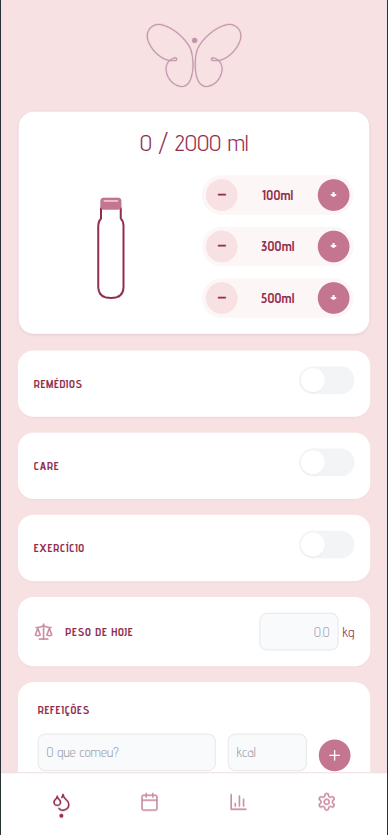
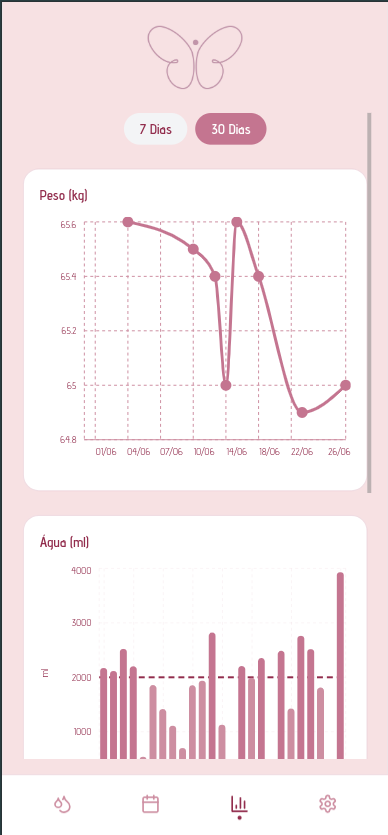

<div align="center">
  

  <h1>Desborocoxando</h1>

  <p><strong>Tracking de hábitos diários — água, peso, refeições, medicação, skincare, exercício — 100% offline, bonito e sem complicação.</strong></p>

  <!-- Badges -->
  <p>
    <a href="https://github.com/JonathanCosta/desborocoxando/actions"></a>
    
    
    
    
  </p>

  <h3>
    <a href="https://jonathancosta.github.io/desborocoxando/">🚀 Acessar o Aplicativo Ao Vivo</a>
  </h3>
</div>

<br/>

Desborocoxando é um aplicativo web progressivo (PWA) para pessoas que desejam registrar e visualizar seus hábitos diários de forma simples, privada e agradável. Tudo fica salvo no próprio navegador — sem contas, sem servidores, sem depender de internet. Cada gole d'água, cada refeição, cada medicamento tomado vira um ponto no gráfico e um dia preenchido no calendário de consistência.

---

## 📸 Telas do Aplicativo

> 🖼️ **Adicione aqui 3 prints do app rodando no celular:**
> Salve como `docs/assets/dashboard.png`, `docs/assets/calendar.png` e `docs/assets/analytics.png`

<!--
<div align="center">
  
  &nbsp;&nbsp;&nbsp;
  
  &nbsp;&nbsp;&nbsp;
  
</div>
-->

---

## ✨ Funcionalidades

- **Dashboard com garrafa interativa** — toque para registrar copos de água com feedback visual e animação.
- **Calendário de consistência** — visão mensal dos hábitos cumpridos, com cores por intensidade (perfeito, parcial, vazio).
- **Analytics com gráficos** — evolução de peso, consumo de água e consistência de hábitos via Recharts, com filtro 7/30 dias.
- **Backup e restore** — exportação e importação dos dados em JSON para migração ou segurança, com validação tripla.
- **PWA instalável** — funciona offline, pode ser adicionado à tela inicial no Android e iOS com modal adaptativo.
- **100% offline-first** — sem chamadas de rede, sem dependência de backend, sem rastreamento.

---

## 📱 Como instalar no seu celular

Por ser um PWA (Progressive Web App), o Desborocoxando não está nas lojas de aplicativos. Para instalar:

1. **Android:** Acesse o app pelo navegador Chrome. Um aviso para "Instalar App" aparecerá na parte inferior, ou você pode acessar o menu do Chrome e clicar em **"Adicionar à tela inicial"**.
2. **iOS (iPhone):** Acesse o app pelo Safari. Toque no ícone de Compartilhar (o quadrado com uma seta para cima) e selecione **"Adicionar à Tela de Início"**.

---

## 🧰 Stack

| Camada | Tecnologia |
|---|---|
| Framework | React 18 |
| Linguagem | TypeScript (strict mode) |
| Bundler | Vite 5 |
| Estilização | Tailwind CSS 3 |
| Gráficos | Recharts 2 |
| Validação | Zod |
| Datas | date-fns |
| Ícones | Lucide React |
| Testes | Vitest + Testing Library |
| PWA | vite-plugin-pwa (generateSW) |

---

## 📁 Estrutura de diretórios

```
desborocoxando/
├── .github/workflows/         # CI/CD — GitHub Actions para deploy
│   └── deploy.yml
├── .opencode/                 # Agentes e skills da arquitetura opencode
│   ├── agent/                 # Definição dos subagentes (coordinator, ui-engineer, etc.)
│   ├── command/               # Comandos personalizados
│   └── skills/                # Skills especializadas (design-system, pwa-mechanics, etc.)
├── docs/                      # Blueprints de frontend, execução e assets visuais
├── public/                    # Ícones e logo do PWA
├── src/
│   ├── assets/                # Recursos estáticos
│   ├── components/            # Componentes React (Dashboard, CalendarView, Analytics, Settings)
│   ├── hooks/                 # Hooks customizados (useAppData, useBackup, usePWA, useSettings)
│   ├── test/                  # Setup global de testes (localStorage mock, etc.)
│   ├── types/                 # Interfaces TypeScript (DailyRecord, Meal, AppDatabase)
│   ├── utils/                 # Funções utilitárias (dateUtils, populateMockData)
│   ├── App.tsx                # Componente raiz com navegação por abas
│   ├── index.css              # Estilos globais, keyframes e diretivas Tailwind
│   ├── main.tsx               # Entry point do React
│   └── schemas.ts             # Schemas Zod centralizados
├── index.html
├── package.json
├── tailwind.config.js
├── tsconfig.json
├── vite.config.ts
└── vitest.config.ts
```

---

## 🚀 Como rodar o projeto

```bash
npm install            # Instala as dependências
npm run dev            # Inicia o servidor de desenvolvimento (Vite)
npm test               # Executa a suíte de testes (Vitest)
npm run build          # Gera o build de produção (tsc + vite build)
npm run preview        # Pré-visualiza o build localmente
```

---

## 📐 Convenções

**Commits** seguem o padrão [Conventional Commits](https://www.conventionalcommits.org/):

| Tipo | Uso |
|---|---|
| `feat:` | Nova funcionalidade |
| `fix:` | Correção de bug |
| `style:` | CSS / formatação (sem mudar lógica) |
| `refactor:` | Refatoração de código |
| `test:` | Testes |
| `chore:` | Setup, build, configuração |
| `docs:` | Documentação |
| `perf:` | Performance |
| `security:` | Segurança |

**Branches** seguem a nomenclatura:

- `feature/nome-da-feature` — novas funcionalidades
- `fix/nome-do-bug` — correções
- `refactor/nome-do-arquivo` — refatorações

**Pré-commit checklist:** antes de todo commit, o projeto valida `tsc --noEmit`, `npm run lint` e `npm test` — garantindo que zero erros de tipo, zero warnings de lint e todos os testes verdes entrem no repositório.

---

## 👥 Público-alvo

Desborocoxando foi feito para pessoas que querem acompanhar hábitos diários sem abrir mão da privacidade e do bom design. É para quem já tentou apps complexos demais, cheios de notificações e planos pagos, e prefere algo direto ao ponto: registrar o copo d'água, ver o progresso da semana, manter a consistência — tudo offline, sem criar conta, sem entregar dados.

---

## Camada de Dados, Estado e Persistência Offline

O Desborocoxando adota **localStorage** como única fonte de dados — não há servidor, API ou banco externo. Todo o registro de hábitos, refeições, água e peso vive no navegador do usuário e nunca o abandona sem seu consentimento explícito (via export/import). Essa escolha prioriza simplicidade, privacidade e 100% de funcionalidade offline.

### Estrutura de Dados

O banco é tipado em duas camadas: **TypeScript em compile-time** e **Zod em runtime**. As interfaces ficam em `src/types/index.ts`:

```typescript
export interface Meal {
  id: string;
  descricao: string;
  kcal: number;
}

export interface DailyRecord {
  date: string;            // "YYYY-MM-DD"
  water: number;           // ml
  meds: { done: boolean; note: string };
  care: { done: boolean; note: string };
  exercise: { done: boolean; note: string };
  meals: Meal[];
  weight: number | null;
}

export type AppDatabase = Record<string, DailyRecord>;
```

O schema Zod equivalente em `src/schemas.ts` adiciona constraints de runtime — `water` e `kcal` nunca negativos, `date` validado por regex `^\d{4}-\d{2}-\d{2}$`, `weight` aceitando `null`:

```typescript
export const DailyRecordSchema = z.object({
  date: z.string().regex(/^\d{4}-\d{2}-\d{2}$/),
  water: z.number().min(0),
  meds: z.object({ done: z.boolean(), note: z.string() }),
  care: z.object({ done: z.boolean(), note: z.string() }),
  exercise: z.object({ done: z.boolean(), note: z.string() }),
  meals: z.array(MealSchema),
  weight: z.number().min(0).nullable(),
});

export const AppDatabaseSchema = z.record(z.string(), DailyRecordSchema);
```

A função `emptyRecord(date)` gera o dia padrão vazio, usado como fallback sempre que `db[selectedDate]` é `undefined`:

```typescript
export const emptyRecord = (date: string): DailyRecord => ({
  date,
  water: 0,
  meds: { done: false, note: '' },
  care: { done: false, note: '' },
  exercise: { done: false, note: '' },
  meals: [],
  weight: null,
});
```

### Hook `useAppData`

Centraliza o estado global do banco. Na inicialização, lê `localStorage` sob a chave `desborocoxando_data`, aplica `AppDatabaseSchema.safeParse()` e, em caso de falha (dados corrompidos ou primeira execução), retorna `{}`.

```typescript
const [db, setDb] = useState<AppDatabase>(() => {
  const raw = localStorage.getItem(STORAGE_KEY);
  if (raw) {
    const parsed = JSON.parse(raw);
    const result = AppDatabaseSchema.safeParse(parsed);
    if (result.success) return result.data as AppDatabase;
  }
  return {};
});
```

A persistência usa `useEffect` com um `isFirstRender` ref, garantindo que o primeiro ciclo de render **não** salve dados vazios sobre um banco existente — a chamada a `localStorage.setItem` só ocorre a partir da segunda renderização:

```typescript
const isFirstRender = useRef(true);

useEffect(() => {
  if (isFirstRender.current) {
    isFirstRender.current = false;
    return;
  }
  localStorage.setItem(STORAGE_KEY, JSON.stringify(db));
}, [db]);
```

O hook expõe:

- `getCurrentRecord()` — retorna `db[selectedDate] ?? emptyRecord(selectedDate)`
- `updateRecord(partial)` — mescla `Partial<DailyRecord>` no dia corrente
- `updateWater(delta)` — aplica o delta ao consumo de água com clamp a zero: `Math.max(0, current.water + delta)`. Isso impede que cliques involuntários levem o contador a valores negativos.
- `populateMockData()` — injeta 365 dias de dados sintéticos via `generateMockData()`, usado exclusivamente em desenvolvimento.

A navegação temporal é feita por `selectedDate` — um estado string independente do relógio real, permitindo que o usuário navegue livremente entre passado e futuro.

### Hook `useSettings`

Metas configuráveis (`waterGoal` e `weightGoal`) vivem em chave separada do `localStorage` (`desborocoxando_settings`). O schema Zod impõe limites sanitários de 0 a 10000:

```typescript
export const SettingsSchema = z.object({
  waterGoal: z.number().min(0).max(10000),
  weightGoal: z.number().min(0).max(10000),
});
```

Os defaults são `{ waterGoal: 2000, weightGoal: 70 }`. O padrão de persistência é idêntico ao do banco principal — leitura na inicialização com fallback, `useEffect` com proteção de primeira renderização.

### Hook `useBackup`

Oferece export e import do banco completo:

- **`exportData()`** — serializa `localStorage` para `Blob` e dispara download como `desborocoxando-backup.json`.
- **`importData(file)`** — lê o arquivo, valida em três etapas: (1) parse JSON, (2) verificação de que todas as chaves são datas `YYYY-MM-DD` via `isValidDate()`, (3) validação completa com `AppDatabaseSchema.safeParse()`. Em caso de sucesso, sobrescreve o `localStorage` e chama `window.location.reload()` para forçar a recarga.

### Por que essas decisões

| Decisão | Motivação |
|---|---|
| **localStorage** | Zero server, 100% offline, sem dependência externa, sem latência de rede. Suficiente para o volume de dados do projeto (~50 KB para um ano de registros). |
| **Validação dupla (TS + Zod)** | TypeScript detecta erros em desenvolvimento; Zod protege contra dados corrompidos no `localStorage` ou arquivos de backup malformados em produção. |
| **Persistência diferida** | O `useEffect` com `isFirstRender` evita que uma inicialização limpa sobrescreva dados existentes — o primeiro `setState` não dispara escrita. |
| **Chave separada para settings** | Metas mudam com pouca frequência; separar evita reescritas desnecessárias do banco principal e permite migrações independentes de schema. |
| **Clamp do `updateWater` a 0** | Impede estado inconsistente (água negativa) por bugs de UI ou race conditions em cliques rápidos. |
| **`emptyRecord` como fallback** | Garante que qualquer data consultada tenha uma estrutura válida, eliminando verificações de nulidade espalhadas pelos componentes. |

---

## Interface, Design System e Micro-Interações

### Design System — Paleta Rosa

A paleta de cores foi inspirada em tons florais rosas, escolhidos por transmitirem acolhimento, consistência e identidade visual marcante. O contraste entre o fundo claro e o texto bordô alcança ~7:1 (WCAG AA), garantindo legibilidade:

| Token | HEX | Uso |
|---|---|---|
| Rosa Claro (Fundo) | `#f7e1e3` | Background geral, tooltips |
| Rosa Médio (Bordas) | `#cd8ea1` | Bordas de card, nav inferior, placeholder |
| Rosa Escuro (Ação) | `#c47590` | Botões, toggle ativo, gráficos, água cheia |
| Bordô (Destaque) | `#922d4d` | Textos principais, ícone ativo, meta |
| Branco | `#ffffff` | Cards, nav inferior |

### Tipografia

A fonte **Advent Pro** (Google Fonts) é usada para títulos e valores numéricos — seu design geométrico e espaçado combina com a identidade floral e dá destaque a métricas como `2500 ml` ou `68.5 kg`. O corpo usa `font-sans` do sistema. Pesos: `font-semibold` para botões, `font-bold` para totais e dias ativos.

### Layout mobile-first

Toda a interface assume viewport ≤ 768px. O container máximo é `max-w-md mx-auto` com sombra lateral simulando um app nativo. A navegação inferior é fixa com `fixed bottom-0 left-1/2 -translate-x-1/2`. Cards usam `bg-white rounded-2xl shadow-sm` e botões têm formato pílula (`rounded-full`). Transições seguem `transition-all duration-300 ease-in-out` com efeito de clique `active:scale-95`.

### Componentes

**App.tsx** — shell com 4 abas (Dashboard, Calendar, Analytics, Settings) e bottom navigation com indicador de aba ativa (bolinha branca sobre fundo bordô).

**Dashboard** — o coração do app. Contém:
- Garrafa SVG animada com nível de água dinâmico (altura proporcional a `water/waterGoal`)
- Botões de água em três valores (100, 300, 500ml) com controles +/−
- Toggles de hábitos (Meds, Care, Exercise) com switch minimalista e campo de nota expansível
- Input de peso com validação de valor negativo
- CRUD completo de refeições com descrição, kcal e botão de exclusão

**CalendarView** — calendário mensal que classifica cada dia como:
- **Perfect** (fundo rosa escuro): água ≥ meta + todos os 3 hábitos feitos
- **Partial** (borda rosa): pelo menos um registro no dia
- **Empty** (sem cor): nenhum registro

Inclui navegação entre meses e resumo de "dias perfeitos".

**Analytics** — três gráficos Recharts com filtro 7/30 dias:
1. **Peso (LineChart)** — com `connectNulls` para dias sem registro e `ReferenceLine` para a meta
2. **Água (BarChart)** — barras coloridas (rosa escuro se ≥ meta, rosa médio se abaixo) com `ReferenceLine`
3. **Consistência de Hábitos (AreaChart)** — stacking de 0 a 3 hábitos por dia com tooltip customizado

**Settings** — configurações com export/import backup, metas de água e peso, instalação PWA com modal adaptativo (Android vs iOS), e botão dev-only para popular 365 dias de dados de teste.

### Micro-animações

- **Balanço da garrafa** — keyframe `balancoGarrafa` de 600ms ao clicar nos botões de água, aplicado via classe `animate-garrafa-balanco`
- **Preenchimento da garrafa** — SVG com `clipPath` e `transition-all duration-500 ease-in-out` na altura do retângulo de água
- **Expansão de inputs** — campos de nota aparecem com `max-h` + `opacity` em `transition-all duration-300`
- **Pulso de alerta** — `animate-pulse` do Tailwind com `text-[#922d4d] font-bold` quando água > meta
- **Sheet modal** — modal de instalação PWA com `translate-y-0`/`translate-y-full` e `duration-500`
- **Indicador de aba** — bolinha na nav inferior com `transition-all duration-300`

### Ícones

Todos os ícones vêm do pacote **Lucide React**: `Droplets`, `Calendar`, `BarChart3`, `Settings`, `Trash2`, `Scale`, `Download`, `Upload`, `Share2`, `X`, `Beaker`, `ChevronLeft`, `ChevronRight`.

---

## Progressive Web App

O Desborocoxando é uma PWA completamente funcional, permitindo instalação no dispositivo e operação offline. A estratégia prioriza simplicidade e experiência do usuário, delegando ao Workbox a gestão do Service Worker enquanto o código foca na lógica de instalação multiplataforma.

### vite-plugin-pwa

A configuração central usa o pacote `vite-plugin-pwa` com `registerType: 'autoUpdate'` e estratégia `generateSW` — o Service Worker é gerado automaticamente pelo Workbox durante o build, sem necessidade de escrever um SW manualmente. O manifesto segue a especificação Web App Manifest:

- **name:** Desborocoxando / **short_name:** Desboro
- **theme_color:** `#c47590` / **background_color:** `#f7e1e3`
- **display:** `standalone` com `display_override: ['window-controls-overlay', 'standalone']`, garantindo experiência imersiva em plataformas desktop que suportam o titlebar personalizado do Windows
- **orientation:** `portrait-primary`
- **start_url** e **scope** definidos para `/desborocoxando/`

### Ícones multiplataforma

Os assets de ícone residem em `public/pwaicons/` e cobrem todos os cenários:

| Plataforma | Tamanhos |
|---|---|
| iOS | 180×180, 152×152, 144×144, 120×120 |
| Android | 192×192 (maskable), 512×512 (maskable) |
| PWA geral | 192×192, 512×512 |

### Hook usePWA

O hook `usePWA` (`src/hooks/usePWA.ts`) encapsula toda a lógica de detecção e instalação:

1. **Detecção de iOS** — usa `navigator.userAgent` para identificar iPad/iPhone/iPod (excluindo MSStream para evitar falsos positivos)
2. **Detecção standalone** — combina `matchMedia('(display-mode: standalone)')` com `navigator.standalone` (legado Safari). Se o app já estiver instalado, o modal não é exibido
3. **Captura do evento `beforeinstallprompt`** — intercepta o evento nativo do Chrome, prevenindo o banner automático e armazenando a referência para disparo posterior
4. **`triggerInstall()`** — invoca `prompt()` no evento capturado e aguarda `userChoice`, limpando o estado se o usuário aceitar

### Modal de instalação inteligente

Um modal adaptável exibe instruções específicas conforme a plataforma:

- **Android (Chrome):** botão "Instalar App" que chama `triggerInstall()`, acionando o diálogo nativo do navegador
- **iOS (Safari):** instruções visuais com o ícone de compartilhamento e o passo a passo "Adicionar à Tela de Início"

O modal utiliza animação slide-up (`translate-y-full` → `translate-y-0` com `duration-500`) sobre overlay semitransparente.

### Estratégia offline

O Service Worker utiliza `globPatterns: ['**/*.{js,css,html,ico,png,svg}']` no Workbox, pré-cacheando todos os assets estáticos. Os dados da aplicação são armazenados inteiramente em `localStorage`, tornando o app **100% funcional sem conexão de rede** — o SW serve o shell estático do cache e o estado é reidratado do armazenamento local.

### Por que essas decisões

A escolha por **`generateSW`** elimina a complexidade de gerenciar um Service Worker manualmente, ideal para um app sem lógica de cache personalizada. O **`autoUpdate`** garante que os usuários estejam sempre na versão mais recente. A **detecção de plataforma** é indispensável porque Android e iOS possuem fluxos de instalação fundamentalmente diferentes — enquanto o Chrome expõe um evento programável (`beforeinstallprompt`), o Safari exige intervenção manual do usuário via menu "Compartilhar".

---

## Estratégia de Testes

A suíte de testes foi projetada para garantir a confiabilidade dos hooks de estado, da lógica de persistência local e da renderização dos componentes, usando uma abordagem centrada no comportamento do usuário e em ambiente browser simulado.

### Stack

Os testes utilizam **Vitest** como runner, combinado com **@testing-library/react** e **@testing-library/jest-dom** para renderização e asserções sobre componentes React. O ambiente de execução é o **jsdom**, que simula APIs do navegador sem a necessidade de um headless browser real.

### Suítes de teste

- **`useAppData.test.ts`** (12 testes) — cobre inicialização do banco, leitura e escrita de registros, alternância entre datas, persistência via `useEffect`, e lógica de `updateWater` com delta positivo, negativo, acumulado e clamp a zero
- **`useSettings.test.ts`** (8 testes) — valores padrão, leitura de dados previamente salvos, merge parcial, persistência e fallback para padrão em casos de JSON inválido, schema inválido ou valores negativos
- **`usePWA.test.ts`** (2 testes) — estado inicial e reação ao evento `beforeinstallprompt`
- **`useBackup.test.ts`** (8 testes) — export com e sem dados, import rejeitando JSON malformado, arrays, null, chaves inválidas e schema inválido, além do fluxo feliz
- **`Analytics.test.tsx`** (7 testes) — renderização com banco vazio, com dados válidos, com peso nulo, e estado dos botões de filtro

### Mocks

O arquivo `src/test/setup.ts` define:
- **localStorage mock** global (getItem, setItem, removeItem, clear, length, key)
- **URL.createObjectURL / URL.revokeObjectURL** mockados
- **window.matchMedia** mockado
- **Recharts stub** — todos os componentes do Recharts substituídos por divs simples (jsdom não implementa medições SVG)
- **Fake timers** com `vi.setSystemTime` para datas determinísticas

### Cobertura

Os testes cobrem: hooks de estado com persistência, lógica de instalação PWA, validação de schemas de importação/exportação e renderização de componentes com diferentes estados de dados. Interações do usuário (cliques, atualizações de formulário) são simuladas via `act` e `fireEvent`.

### Por que essas escolhas

- **jsdom**: ambiente browser leve e rápido, ideal para testes unitários e de integração superficial, sem sobrecarga de navegador real
- **Testing Library**: testes que interagem com componentes da mesma forma que o usuário (busca por texto, role, label), reduzindo acoplamento com implementação
- **Mocks centralizados**: isolam dependências externas, tornando os testes rápidos, determinísticos e independentes do ambiente

---

## Segurança, Tipagem e Boas Práticas Arquiteturais

O Desborocoxando opera integralmente no navegador, sem backend. Essa arquitetura *zero-server* elimina diversas superfícies de ataque, mas introduz riscos específicos — principalmente relacionados à integridade dos dados no `localStorage` e à importação de backups.

### TypeScript Strict

O `tsconfig.json` é configurado com `"strict": true`, `"noUnusedLocals": true`, `"noUnusedParameters": true` e `"noFallthroughCasesInSwitch": true`. Essas flags garantem que nenhuma variável morta ou parâmetro não utilizado passe despercebido. O código-fonte não contém **nenhum uso de `any`** — todos os tipos são explícitos e verificados em tempo de compilação.

### Validação dupla: compile-time + runtime

Duas camadas de validação trabalham em conjunto:

- **Compile-time (TypeScript):** interfaces como `DailyRecord`, `Meal` e `AppDatabase` definem o contrato dos dados. O compilador garante que todo acesso a propriedades seja seguro.
- **Runtime (Zod):** schemas como `AppDatabaseSchema` e `SettingsSchema` validam os dados reais que entram do `localStorage`. A função `safeParse()` é usada em toda leitura — se os dados armazenados não corresponderem ao schema (por corrupção, versão antiga ou manipulação manual), são rejeitados silenciosamente com fallback para o estado vazio, sem crash.

### Segurança no localStorage

Toda leitura do `localStorage` segue o mesmo padrão de `safeParse` com fallback. Dados corrompidos ou inesperados nunca causam falha na aplicação. Além disso, **nenhum dado oriundo do `localStorage` é interpolado como HTML** — o código não contém `innerHTML` nem `dangerouslySetInnerHTML`, eliminando o risco de XSS mesmo em um app sem servidor.

### Limites arquiteturais

A separação de responsabilidades é rígida:

| Camada | Acesso ao localStorage | Responsabilidade |
|---|---|---|
| `hooks/` | ✅ Sim | Leitura e escrita do banco offline |
| `components/` | ❌ Não | Renderização da interface |
| `utils/` | ❌ Não | Funções puras (datas, geração de dados mock) |
| `schemas.ts` | ❌ Não | Definição centralizada dos schemas Zod |

Nenhum componente UI acessa `localStorage` diretamente — todo dado chega via *props* provenientes dos hooks. Isso facilita testes, manutenção e substituição futura da camada de persistência.

### ESLint

Regras críticas ativadas como erro:

- `@typescript-eslint/no-explicit-any: error` — proíbe `any` em todo o código
- `react/no-danger: error` — proíbe `dangerouslySetInnerHTML`
- `react-refresh/only-export-components: warn` — assegura que apenas componentes sejam exportados

### Backup seguro (tripla validação)

O fluxo de importação passa por três barreiras antes de sobrescrever o banco:

1. **`JSON.parse` em `try/catch`** — arquivos malformados são rejeitados imediatamente
2. **Verificação de chaves** — cada chave é testada contra a regex `/^\d{4}-\d{2}-\d{2}$/`
3. **Schema Zod completo** — o objeto inteiro é validado por `AppDatabaseSchema.safeParse()`

Apenas após passar pelas três etapas os dados são gravados no `localStorage` e a página é recarregada.

### Por que essas decisões

- **Prevenção de XSS:** mesmo sem servidor, um backup malicioso ou dados manipulados via DevTools poderiam conter HTML injetado. A ausência total de `innerHTML` elimina esse vetor.
- **Proteção contra localStorage corrompido:** atualizações entre versões, extensões de navegador ou falhas de escrita podem corromper o banco local. O `safeParse` com fallback garante que o app nunca quebre.
- **Resiliência na importação:** backups externos passam por validação rigorosa antes de substituir os dados existentes, impedindo que um JSON malformatado deixe o aplicativo inutilizável.

---

## CI/CD e Deploy

### Vite e base path

O empacotamento é feito com Vite usando o plugin `@vitejs/plugin-react` para transformação JSX/TSX e o `vite-plugin-pwa` para geração do Service Worker. Como o projeto é hospedado no GitHub Pages em subdiretório (`https://<user>.github.io/desborocoxando/`), a propriedade `base` do Vite é configurada como `'/desborocoxando/'`, garantindo que os caminhos dos assets sejam resolvidos corretamente em produção.

O manifesto do PWA (`start_url` e `scope`) também reflete esse path, assegurando que o aplicativo funcione corretamente quando instalado como PWA.

### GitHub Actions

O deploy é automatizado por um workflow em `.github/workflows/deploy.yml` com os seguintes gatilhos:

- **Push na branch `main`** — a cada merge, uma nova versão é publicada
- **`workflow_dispatch`** — permite disparar o deploy manualmente pela interface do GitHub

O pipeline executa:

1. **Checkout** (`actions/checkout@v4`) — clona o repositório
2. **Setup Node** (`actions/setup-node@v4`) — configura Node.js 20
3. **`npm ci`** — instala dependências de forma determinística
4. **`npm run build`** — executa `tsc` (type checking) e `vite build` (bundling), gerando `dist/`
5. **Setup Pages** (`actions/configure-pages@v4`) — configura o ambiente GitHub Pages
6. **Upload artifact** (`actions/upload-pages-artifact@v3`) — upload do diretório `dist/`
7. **Deploy** (`actions/deploy-pages@v4`) — publica o artefato diretamente no GitHub Pages, sem branch secundária

### Ambiente e permissões

O workflow define um **environment** `github-pages` com a URL gerada. As permissões do token são:

- `contents: read` — leitura do repositório
- `pages: write` — escrita no GitHub Pages
- `id-token: write` — necessário para autenticação com deploy-pages

Um **concurrency group** `"pages"` com `cancel-in-progress: true` garante que apenas um deploy rode por vez.

### Por que essas decisões

O GitHub Pages foi escolhido por ser uma solução **zero-config** para frontends estáticos, eliminando a necessidade de servidor próprio. O deploy via `actions/deploy-pages` simplifica o pipeline ao publicar artefatos diretamente, sem gerenciar branch separada. O build em dois estágios (`tsc && vite build`) garante que erros de tipo sejam capturados antes do empacotamento.

---

## 📄 Licença

Este projeto está sob a licença MIT. Veja o arquivo [LICENSE](LICENSE) para mais detalhes.

## 👨‍💻 Autor

Desenvolvido com ☕ e código por **Jonathan Costa** utilizando a arquitetura de subagentes autônomos (OpenCode).

- [GitHub](https://github.com/JonathanCosta)
